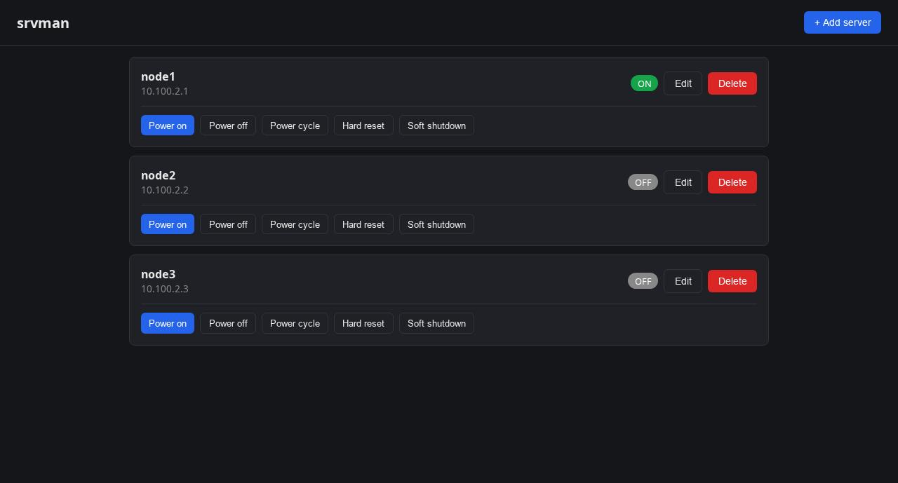
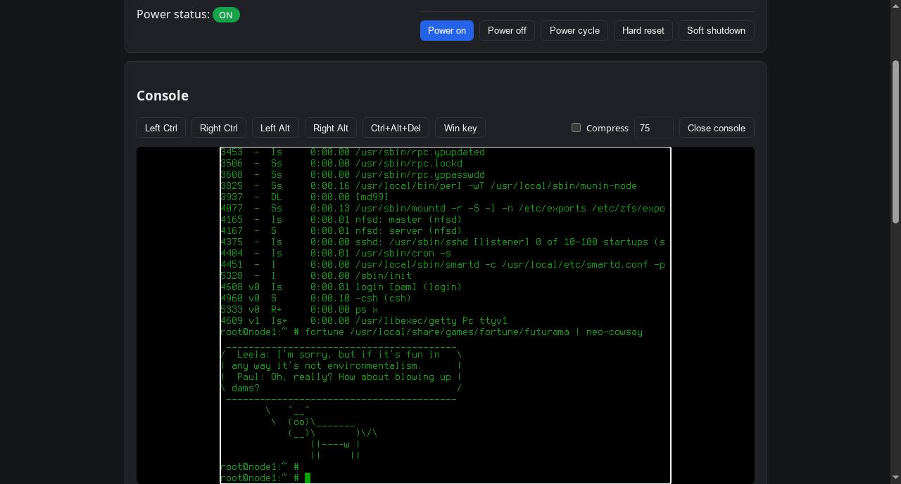
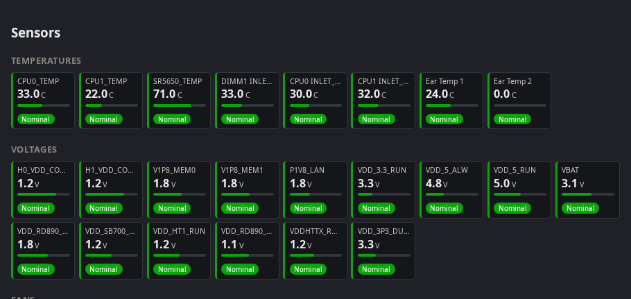

# aspeed-ikvm

A small, dependency-light home-lab tool for managing servers with
AMI MegaRAC / ASPEED AST2050 and AST2500 BMCs: IPMI power control,
sensor and System Event Log views, and a browser-based KVM console
(video, keyboard, mouse) — no Java, no browser plugin, no vendor
client.

## Screenshots

**Server list — power state at a glance, one-click power actions**



**Live KVM console — keyboard and mouse redirected straight from the browser**



**Sensors — temperatures, voltages, fans, pulled over IPMI**



## Why

ASPEED's stock remote-console story on these BMCs is JViewer: a
Java Web Start applet, served from the BMC itself, that most current
browsers won't run anymore without a sketchy standalone JRE install.
There's no documented video or HID protocol behind it — JViewer just
ships the ASPEED AST2000 macroblock video codec and the AMI "IVTP"
framing baked into a `.jar`.

This project reimplements that client side in C++, reverse-engineered
from the JViewer applet's own class files: the TCP login handshake on
port 7578, the `IVTPPktHdr`-framed packet protocol, the AST2000 video
macroblock decoder, and the USB HID key/mouse report format the BMC's
emulated USB keyboard and absolute-position mouse expect. The result
is a single static binary that decodes BMC video server-side and
streams it to any browser over a plain WebSocket — nothing installed
on the client.

## Features

- IPMI power control (on / off / cycle / hard reset / soft shutdown) via `libfreeipmi`
- Sensor readings and System Event Log via `libipmimonitoring`
- Browser KVM console:
  - Live video, decoded server-side from the AST2000 codec
  - Keyboard and absolute-mouse input relayed as real USB HID reports
  - Optional JPEG compression for the video stream, with a
    runtime-adjustable quality slider (no rebuild needed) — useful on
    low-bandwidth links or weak hardware; off by default, raw RGB24
  - Hold-modifier buttons (Ctrl/Alt) and synthesized Ctrl+Alt+Del / Win-key,
    for combinations a browser never lets a page capture directly
- Single static binary, one small SPA (no build step, no framework) for the frontend

## Building

Dependencies: a C++14 compiler, CMake, and `pkg-config`-discoverable
`libfreeipmi`, `libipmimonitoring`, `libgcrypt`. Everything else
(HTTP/WebSocket server, JSON, JPEG encoder) is vendored header-only in
`third_party/` — no package manager, no network access needed at build time.

```sh
# Debian/Ubuntu
sudo apt install build-essential cmake pkg-config \
    libfreeipmi-dev libipmimonitoring-dev libgcrypt20-dev

cmake -B build
cmake --build build -j
```

## Running

```sh
./build/srvman [port]       # default port 8080
./build/srvman --set-password   # interactively set the admin password (no echo)
```

On first run, if no admin account exists yet, one is created with a
random generated password printed once to stdout.

Server inventory lives in `data/servers.json`, relative to the
process's working directory. See [`examples/servers.example.json`](examples/servers.example.json)
for the format — `id` is any unique string, `password` is the BMC's
IPMI/web-UI password in plaintext (file permissions are your
protection here, same as any `/etc/ipmi` credential store).

## How the console works

- `src/ikvm_session.*` — the BMC login handshake and the raw TCP
  protocol on port 7578 (`IVTPPktHdr` framing, USB HID key/mouse
  report packets wrapped in an `IUSB` envelope with a checksum)
- `src/ikvm_decoder.*` — the AST2000 macroblock video codec, ported
  from JViewer's own decoder
- `src/ikvm_bridge.*` — glues a BMC session to a browser WebSocket:
  decodes video frames (optionally re-encoding to JPEG), relays
  keyboard/mouse input the other way

Wire format over the WebSocket, browser-facing:

- Server → browser: `format byte (0 = raw RGB24, 1 = JPEG)`, `width (u16 LE)`, `height (u16 LE)`, then the frame payload
- Browser → server: `1` = key report (modifiers, keycode), `2` = absolute-mouse report (buttons, x, y)

## Known limitations

- No hardware cursor overlay — the BMC sends cursor shape/position
  as a separate packet type; it's currently just discarded
- Only exercised against BMCs announcing absolute mouse mode; the
  relative-mouse path in the protocol is unimplemented
- The JPEG-DCT source frame path (as opposed to the AST2000 macroblock
  path) and the optional RC4 frame encryption are both unexercised —
  the BMCs this was built against never triggered them

## License

MIT — see [LICENSE](LICENSE).
